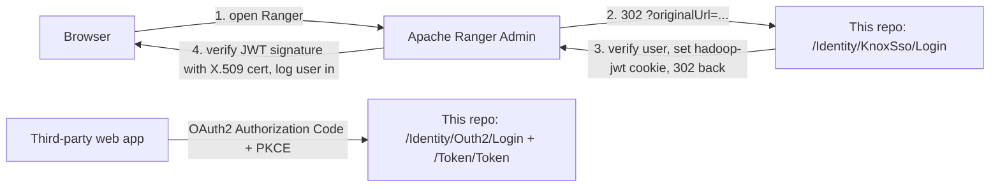

# sso-emulator-ranger-integration

> A custom **OAuth 2.0 SSO server** (Authorization Code + PKCE, client_credentials, UserInfo, JWKS, Discovery, Logout) in **Node.js / Express / PostgreSQL**, modelled on a bank "Smart SSO" - **plus a working Apache Ranger (Knox SSO) integration**, a Rocky Linux deployment guide, and an honest log of every bug we hit and how we fixed it.

It exists to answer one practical question:

> *"We have to connect **Apache Ranger Admin** to a third-party SSO that we don't control and can't change - only read the vendor's developer docs. How do we build and test that safely in-house first?"*

So the repo gives you (1) a faithful **emulator of that SSO's contract**, including its non-standard quirks, (2) a **working Ranger integration** against it, and (3) the **design for the bridge** you need when the real SSO speaks OAuth2 but Ranger only speaks Knox-cookie SSO.

---

## The key insight (read this first)

**Ranger cannot talk OAuth2.** Its `ranger.sso.*` settings implement the *Apache Knox SSO* protocol - a redirect + a signed JWT **cookie** - with no `client_id`, no `client_secret`, no code-for-token exchange. A bank-style OAuth2 SSO returns a one-time `code` that must be exchanged server-side. They are incompatible, so you **cannot** just paste the bank's login URL into `ranger.sso.providerurl`.



This repo implements **both** protocols in one server:

| Protocol | For | Endpoints |
|---|---|---|
| OAuth 2.0 Authorization Code (+PKCE) and client_credentials | Normal web apps / services (emulates the bank SSO contract) | `/Identity/Outh2/Login`, `/Token/Token`, `/UserInfo/GetUserInfo`, `/jwks.json`, `/.well-known/openid-configuration`, `/Identity/Outh2/Logout` |
| Knox SSO cookie handshake | Apache Ranger (and anything else that speaks Knox SSO) | `/Identity/KnoxSso/Login`, `/Identity/KnoxSso/Logout` |

For the real-bank case the missing piece is a **bridge** (Knox on one side, OAuth2 client on the other) - designed in [`docs/06`](docs/06-bridge-design-bank-sso.md), **not yet implemented**.

---

## Status - what is verified and what is not

| Area | Status |
|---|---|
| OAuth2 server (all endpoints, PKCE, quirks) | Implemented. **33-check smoke test passes** against a real PostgreSQL 16 (`npm test`). |
| Knox cookie flow + Ranger certificate | Implemented; JWT verified against the generated X.509 cert. **Integrated and working on Ranger 2.6.0** (login via SSO confirmed in Ranger's logs). |
| One-click logout from Ranger's UI | **Not solved in Ranger.** Workaround + experimental nginx config only - see [limitations](docs/07-limitations-and-security.md). |
| Authenticating against LDAP/FreeIPA instead of the local user table | **Not implemented** (recommended next step). |
| Bridge to a real external OAuth2 SSO | Design only. |
| Hardening (rate limiting, lockout, key encryption, token revocation) | Not implemented - this is a **lab/emulator, not a production IdP**. |

---

## Quick start

Requirements: Node.js >= 20, PostgreSQL >= 13, openssl.

```bash
git clone https://github.com/<your-org>/sso-emulator-ranger-integration.git
cd sso-emulator-ranger-integration
npm install

cp .env.example .env          # then edit DATABASE_URL, SESSION_SECRET, COOKIE_DOMAIN, RANGER_ALLOWED_ORIGINS
npm run migrate               # create tables
npm run genkeys               # generate the RS256 signing key
npm run seed                  # demo client + demo user (prints credentials ONCE)
npm start                     # http://localhost:5205
```

Verify everything with the bundled end-to-end test (uses the credentials printed by `seed`):

```bash
CLIENT_ID=democlient_xxxx CLIENT_SECRET=... REDIRECT_URI=https://app.example.com/auth/callback \
USERNAME=demouser PASSWORD=... RANGER_ORIGIN=http://ranger.example.com:6080 npm test
# Result: 33 passed, 0 failed
```

Production-style install on Rocky Linux (PostgreSQL, firewalld, SELinux, systemd, nginx, co-hosting with FreeIPA): **[`docs/03-installation-rocky-linux.md`](docs/03-installation-rocky-linux.md)**.

## Connect Apache Ranger (summary)

```bash
# 1. SSO server: certificate for Ranger (a CERTIFICATE - not a raw public key!)
npm run --silent ranger-cert | tail -1

# 2. Ranger server: enable SSO (backs up the file, validates the certificate)
python3 ranger/apply-sso-config.py --file /etc/ranger/admin/conf/ranger-admin-site.xml \
   --provider-url http://sso.example.com/Identity/KnoxSso/Login --certificate "<cert>"
sudo systemctl restart ranger-admin
```

Hard requirements: SSO and Ranger on **hostnames under one parent domain** (cookies don't cross raw IPs), and every user must **already exist in Ranger**. Details: **[`docs/04-ranger-integration.md`](docs/04-ranger-integration.md)**.

## Repository layout

```
.
├── src/
│   ├── server.js              Express app + central error handler
│   ├── config/                Environment-driven config
│   ├── routes/
│   │   ├── authorize.js       GET/POST /Identity/Outh2/Login   (login form, PKCE, code issuance)
│   │   ├── token.js           POST /Token/Token                (authorization_code + client_credentials)
│   │   ├── userinfo.js        GET  /UserInfo/GetUserInfo
│   │   ├── discovery.js       GET  /.well-known/openid-configuration
│   │   ├── jwks.js            GET  /jwks.json
│   │   ├── logout.js          GET  /Identity/Outh2/Logout, /Identity/Logout  (origin-only quirk)
│   │   └── knoxSso.js         Knox SSO cookie flow for Apache Ranger
│   ├── lib/                   keys, JWT signing/verification, PKCE, client auth, X.509 generator for Ranger
│   └── db/                    pg pool, migration runner, seed
├── migrations/001_init.sql    clients, users, authorization_codes, access_tokens, signing_keys
├── scripts/create-user.js     add/update an SSO user
├── ranger/                    apply-sso-config.py + annotated config snippet
├── deploy/                    systemd unit, nginx configs (SSO proxy; experimental Ranger-logout proxy)
├── test/smoke.sh              33-check end-to-end test
├── test/fixtures/             real (masked) Ranger 2.6.0 config before/after enabling SSO
└── docs/                      see below
```

## Documentation

| # | Document | What's in it |
|---|---|---|
| 1 | [Architecture](docs/01-architecture.md) | Components, both flows as sequence diagrams, data model, token anatomy, key management |
| 2 | [Modelled SSO analysis](docs/02-modelled-sso-analysis.md) | What the vendor's developer docs specify, and the quirks we deliberately replicate |
| 3 | [Installation on Rocky Linux](docs/03-installation-rocky-linux.md) | PostgreSQL, firewalld, SELinux, systemd, nginx, DNS, running beside FreeIPA |
| 4 | [Ranger integration](docs/04-ranger-integration.md) | How it works, step-by-step, user mapping, verification, rollback |
| 5 | [**Bug & fix log**](docs/05-troubleshooting-bugs-log.md) | Every problem we hit, symptom → root cause → fix |
| 6 | [Bridge design for a real bank SSO](docs/06-bridge-design-bank-sso.md) | What to build and what to ask the SSO provider for |
| 7 | [Limitations & security](docs/07-limitations-and-security.md) | Logout, user switching, session timing, ghost users, hardening gaps |
| 8 | [API reference](docs/08-api-reference.md) | Every endpoint with curl examples and response shapes |
| 9 | [Post-install checklist](docs/09-post-install-checklist.md) | What to change/verify after installing |

## Security notice

This is a **learning/integration-testing emulator**. It has no rate limiting or account lockout, stores the JWT signing private key unencrypted in PostgreSQL, keeps its own password table, and has no token revocation. Do not expose it to the internet as your real identity provider without addressing [`docs/07`](docs/07-limitations-and-security.md). Never commit `.env`, keys or the vendor's PDFs (all covered by `.gitignore`).

## License

[MIT](LICENSE)
