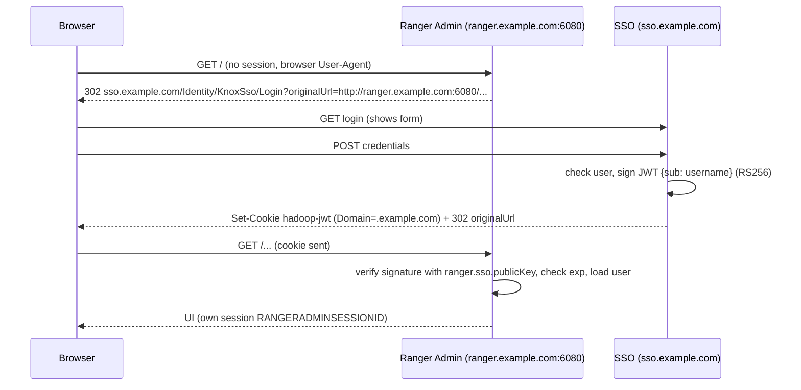

# 4. Connecting Apache Ranger Admin

Tested on **Ranger Admin 2.6.0** with both internal and LDAP (FreeIPA) authentication enabled.

## How it works

Ranger's `ranger.sso.*` support is the **Apache Knox SSO** protocol:



There is no client id/secret and no code exchange. Trust rests entirely on Ranger holding the SSO's certificate.

## Prerequisites

1. **Hostnames, not IPs**, under one parent domain (DNS, or `/etc/hosts` on each *client* machine): `sso.example.com`, `ranger.example.com`.
2. SSO `.env`: `COOKIE_DOMAIN=.example.com`, `RANGER_ALLOWED_ORIGINS=http://ranger.example.com:6080`, `COOKIE_SECURE=false` for HTTP (set `true` once on HTTPS).
3. The user exists **in Ranger** (see below).
4. A working Ranger first (check the UI loads with internal login *before* enabling SSO).

## Steps

```bash
# --- on the SSO server ---
npm run --silent ranger-cert | tail -1        # base64 body of an X.509 certificate

# --- on the Ranger server ---
python3 ranger/apply-sso-config.py \
  --file /etc/ranger/admin/conf/ranger-admin-site.xml \
  --provider-url http://sso.example.com/Identity/KnoxSso/Login \
  --certificate "<paste>" --dry-run            # review the diff
# repeat without --dry-run, then:
sudo systemctl restart ranger-admin
```

The script edits only these properties (see [`ranger/ranger-admin-site.sso-snippet.xml`](../ranger/ranger-admin-site.sso-snippet.xml) and the before/after fixtures):

| Property | Value |
|---|---|
| `ranger.sso.enabled` | `true` |
| `ranger.sso.providerurl` | `http://sso.example.com/Identity/KnoxSso/Login` |
| `ranger.sso.publicKey` | base64 body of the X.509 certificate (**not** a raw public key) |
| `ranger.sso.cookiename` | `hadoop-jwt` (= `RANGER_COOKIE_NAME`) |
| `ranger.sso.query.param.originalurl` | `originalUrl` |
| `ranger.sso.browser.useragent` | `Mozilla,chrome` |

LDAP/internal settings are untouched. Because only browser User-Agents are redirected, **API clients (curl, usersync, plugins) keep using basic/LDAP auth.**

## User mapping

The JWT `sub` must equal an existing Ranger login name. Create the user in Ranger first (UI: Settings → Users/Groups, or REST):

```bash
curl -u admin:'<admin-password>' -H 'Content-Type: application/json' \
  -X POST http://ranger.example.com:6080/service/xusers/secure/users \
  -d '{"name":"demouser","password":"<Ranger-compliant-password>","firstName":"Demo","lastName":"User","userRoleList":["ROLE_USER"],"status":1}'
```

(Check the exact payload against your Ranger version; the UI is the safest way.) Add the same user to the SSO with `NEW_USER_PASSWORD=... npm run create-user -- demouser`. With LDAP usersync, users appear automatically.

## Verify

1. Private window → `http://ranger.example.com:6080` → redirected to the SSO form → log in → back in Ranger.
2. DevTools → Application → Cookies: `hadoop-jwt` present, domain `.example.com`.
3. Ranger log (path varies; e.g. `/usr/lib/ranger-admin/ews/logs/ranger-admin-*.log`) should contain `SSO login user : <name>`.
4. `curl -u user:pass http://ranger.example.com:6080/service/public/v2/api/servicedef` still works (no SSO redirect for non-browsers).

## Rollback

```bash
sudo cp /etc/ranger/admin/conf/ranger-admin-site.xml.bak.<timestamp> /etc/ranger/admin/conf/ranger-admin-site.xml
sudo systemctl restart ranger-admin
```
Or set `ranger.sso.enabled` to `false`.

## Post-install changes we needed

| Change | Where | Why |
|---|---|---|
| MySQL `read_only=0`, persisted in `my.cnf` | Ranger DB host | Ranger UI 404 otherwise ([bug 7](05-troubleshooting-bugs-log.md)) |
| Hostnames + shared cookie domain | DNS / `/etc/hosts`, `.env` | Cookie must reach both services |
| Users pre-created in Ranger | Ranger | Avoid "ghost user" read-only sessions |
| `RANGER_ALLOWED_ORIGINS` set | SSO `.env` | Redirect allowlist, otherwise login refuses to redirect |

## Known limits

Logout/user-switching, 300 s JWT vs. longer Ranger session, and `admin` access: see [07](07-limitations-and-security.md).
