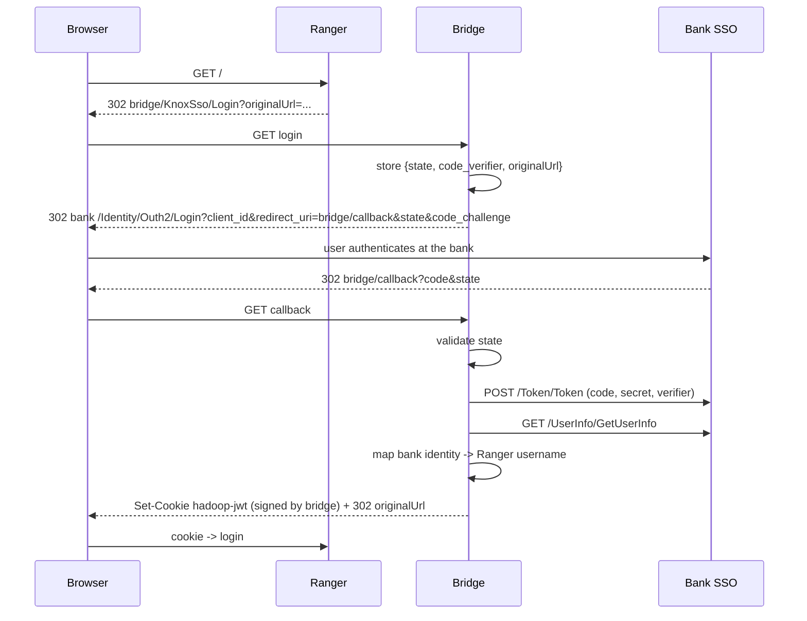

# 6. Bridge design for a real (OAuth2) bank SSO

> **Status: design only. Not implemented in this repo.**

## The problem
Ranger speaks Knox SSO (redirect + signed cookie). The bank SSO speaks OAuth2 Authorization Code (+PKCE). They cannot be connected directly: Ranger has nowhere to put a `client_id`/`client_secret` or perform the code exchange.

## The design
A small **bridge service** is both: a Knox-style provider *toward Ranger* and an OAuth2 client *toward the bank*.

Ranger is configured exactly as in [04](04-ranger-integration.md), with `providerurl` pointing at the bridge and `publicKey` = the **bridge's** certificate. This repo's `/Identity/KnoxSso/*` code, signing and certificate generator can be reused as the Ranger-facing half.

## Open questions for the bank (ask these before building)
1. Register a client: `client_id`, `client_secret`, our **redirect URI** (the bridge callback), scopes (`openid`, `profile`, `EmployeeCode`?), `UsePkce` setting.
2. **Which claim is the Ranger username?** Employee code, national id, or an account name? It must match what exists in Ranger/LDAP. (`EmployeeCode` scope suggests a numeric id - you may need a mapping table.)
3. Are redirect URIs over plain HTTP allowed, or HTTPS only? Is a non-production environment available?
4. Does the bank honour logout redirects, and what is the SSO session length?
5. Network path: can the bridge reach the bank's token/userinfo endpoints (firewall, proxy, TLS CA)?

## Implementation notes
- Validate `state` and keep PKCE verifiers server-side, short-lived, single-use.
- Verify the id/access token signature using the bank's JWKS if a JWT is returned.
- Reuse the `RANGER_ALLOWED_ORIGINS` allowlist.
- Decide what happens for users that exist at the bank but not in Ranger (deny, or provision via the Ranger REST API).
- Same logout limitation as in [07](07-limitations-and-security.md).
